# 🥕 Bunny Beat Down

[](https://github.com/zconnor100-debug/bunny-beat-down/actions/workflows/tests.yml)


**A whimsical third-person survival roguelike.** One bunny in an acorn helmet
against up to 49 bots who remember you: rivals with grudges, a nemesis who
hunts you and steals your gun, runs down a branching trail of five matches
with boons that build into something silly (carrots that split, pierce,
bounce and pop), perks that carry over between runs, and rewinds to undo
your worst ten seconds. Drop from a picnic-basket hot-air
balloon onto a procedurally generated forest island (or from a wind-up toy
plane into a giant hamster cage, or a paper airplane over a kid's bedroom
floor) and loot carrot guns. Then outlast the
closing Briar and be the last critter standing. Ragdolls, real limb-popping
gore, and floppy physics ears are included.

Built in **Godot 4.6** (GDScript, Jolt physics, Forward+).

▶ **[The Hunt](docs/trailer_hunt_phone.mp4)**, a 30-second phone trailer (with
sound): Bun is the quarry of a hunting party of the Cast's nobles across all
three maps (Buck Toothington sounds the "Tally-ho!", Sir Reynard wants you to
keep running, it's terribly sporting), and the quarry bites back: a rocket,
a golden shotgun and the toy train, the ragdolls in slow motion.

▶ **[The 30-second trailer](docs/trailer_1080p.mp4)** in 1080p (with sound;
also [cut for phones](docs/trailer_phone.mp4)):
30-critter brawls on all three maps, the toy train ploughing through a
battle, a rocket into a huddle in slow motion, carrots that split and pop, a
nemesis and its gang, and the rewind.

▶ **[The island trailer](docs/trailer.mp4)**: a rival sneaks up on you, you
rewind, and this time you turn around.

▶ **[The Hamster Cage cut](https://github.com/zconnor100-debug/bunny-beat-down/releases/download/v0.6.0/trailer_hamster_cage.mp4)**: up the Hamster
Gym's see-through tubes, a rewind you can watch, and the final shot slowed
down and replayed. There's also a **[vertical phone cut](https://github.com/zconnor100-debug/bunny-beat-down/releases/download/v0.6.0/trailer_hamster_cage_vertical.mp4)**.

▶ **[The Toy Box Bash cut](https://github.com/zconnor100-debug/bunny-beat-down/releases/download/v0.6.0/trailer_toybox.mp4)**: a paper-airplane
drop, a ride on the toy train, the rewind running the whole train backwards,
and the final shot replayed from three angles. There's a
**[vertical phone cut](https://github.com/zconnor100-debug/bunny-beat-down/releases/download/v0.6.0/trailer_toybox_vertical.mp4)** of it too.

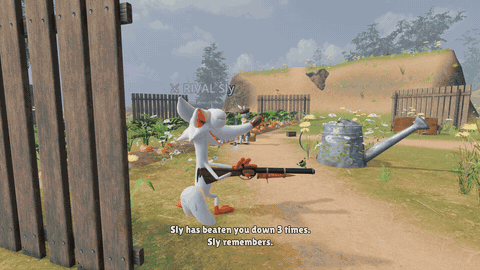

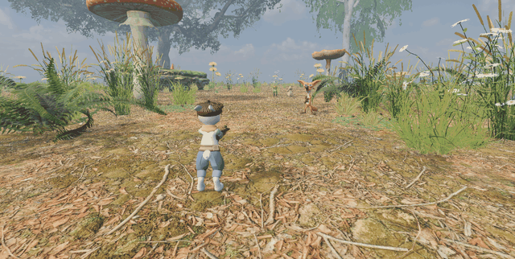

| | |
|---|---|
| 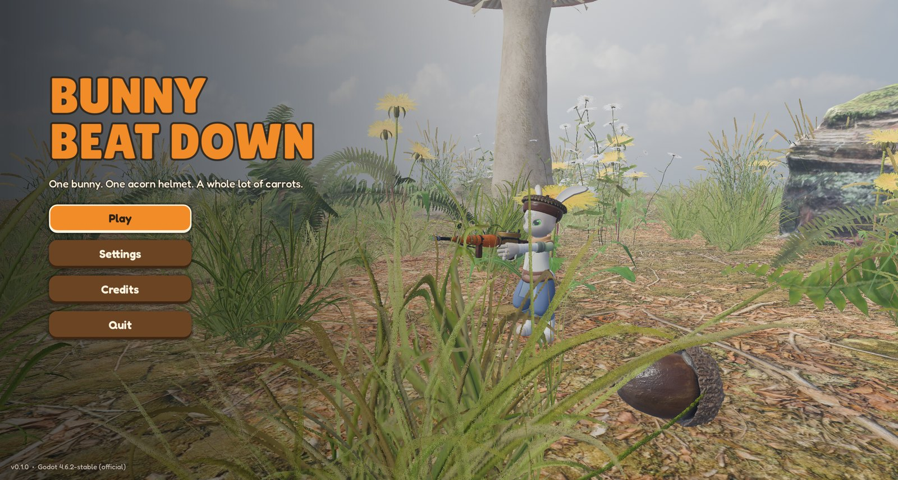 | 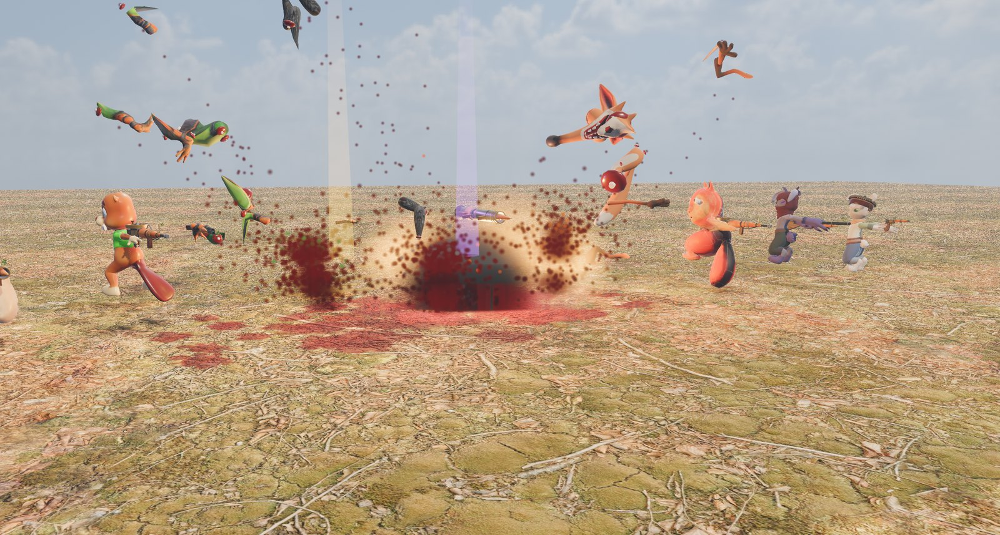 |
| 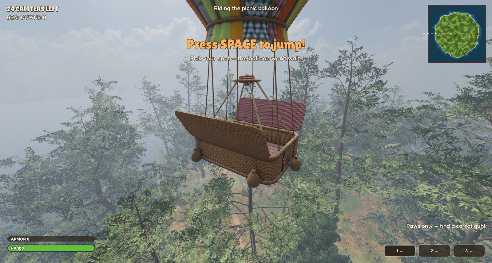 | 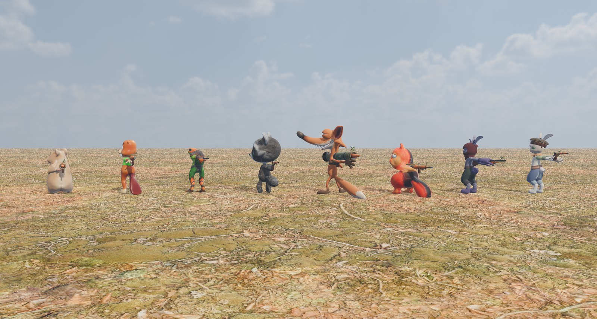 |

## Features

- **Third person with a first-person option** (press **V**): over-the-shoulder
  camera with a shoulder swap, aim-down-sights zoom, recoil kick and trauma
  shake; a first-person viewmodel with sway, bob and procedural reloads.
- **Seven carrot guns**, each with its own feel:

  | Gun | Role | Look |
  |---|---|---|
  | Carrot Pistol | snappy sidearm, big headshot bonus | barn-red enamel, an acorn-cap drum, an acorn for a hammer |
  | Carrot SMG | 900 rpm stick-mag of baby carrots, great up close | mustard, a bent-twig stock, a watering-can rose |
  | Carrot Shotgun | nine julienned pellets, pump action | cornflower blue, a copper bell-flower mouth, acorn hammers |
  | Carrot Assault Rifle | the all-rounder, banana-carrot magazine | teal, a bark-wrapped handguard |
  | Carrot LMG | a pan of baby carrots and no off switch | sage, a wicker hopper with an acorn on the hub, twig bipod |
  | The Long Carrot | bolt-action sniper with a real scope view; 800 m/s, so little leading | plum, a bamboo scope |
  | Carrot Rocket Launcher | one very large, very angry carrot: 120 on a direct hit, less the further from the blast (out to 10 m) | a hollow bark log tied with twine, a toadstool exhaust |

  They're garden contraptions rather than firearms: each in its own garden
  enamel (chipped to brass), with watering-can copper for bare metal, carrot
  barrels and leafy sights (`tools/weapons/blender/assets/weapons.py`).

  Carrots fly fast enough that you barely lead a running critter at the
  range each gun is made for: 260 m/s for shotgun pellets up to 480 for the
  rifle (the sniper's 800 is the ceiling; the rocket stays a slow 120 and
  makes up for it with its blast).

  **Trackers**: every gun keeps its own count (beat-downs, carrots fired,
  hits, accuracy, headshots, damage, the longest beat-down), shown by its
  name in the HUD (⚔ 37), and every critter you play keeps its matches,
  wins, best placing, beat-downs per defeat and accuracy. The end screen
  sums up the match; the **Trophy Room** (main menu) has the lot.

  Five loot rarities run from Baby to **Golden**, and Golden guns shimmer.
  Projectiles are real carrots that take time to arrive (lead a moving
  target) and **stay stuck** in whatever they hit. Shooting is meant to be
  readable rather than realistic:
  - Within a gun's range, a carrot lands where the crosshair is; past it,
    the drop starts to show.
  - Automatics put the first three shots of a burst where you aim, and
    spread out the longer you hold the trigger. A short break settles them.
  - The shotgun throws a learnable pattern (one pellet down the middle, the
    rest in a ring) instead of a random cone.
  - Walking and strafing barely cost accuracy; sprinting and jumping do.
- **Species jump tricks**: every critter jumps in character.
  - **Bunnies flip**: a front flip when running forward, a back flip when
    backing up, a side flip when strafing.
  - Squirrels spin, foxes do a head-first mousing pounce, and raccoons
    cannonball.
  - Frogs stretch out into a leap, beavers land with a tail slap, and
    hamsters barrel-roll.

  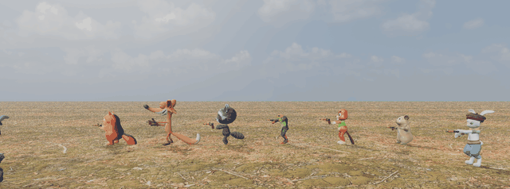
- **Pick your critter** on the loading screen while the island grows:
  - all eight species (bunnies, squirrel, fox, raccoon, frog, beaver, hamster),
    each with several skins;
  - a live 3D preview showing the species' jump trick.

  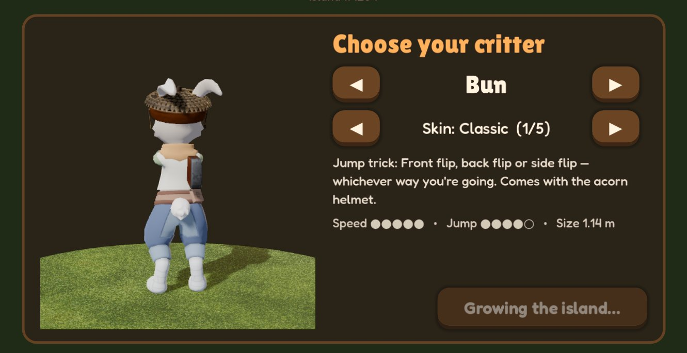
  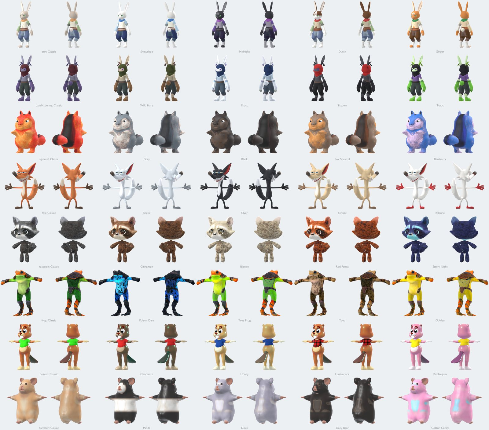
- **Last critter standing: 1 player against up to 49 bots** on three maps (pick one
  under *New match*): Wildwood Island, the Hamster Cage and Toy Box Bash:
  - a balloon (or toy-plane, or paper-airplane) drop, freefall, and a giant
    leaf, flower or dandelion umbrella to glide down on;
  - floor loot, garden crates and **treasure chests**: hold E for up to 5 s,
    out in the open, for the best gear;
  - big glowing pickups: green **lucky clover** bottles to heal and orange
    **acorn shields** for armor;
  - critter cottages, stumps, log piles and stone walls for cover;
  - the shrinking **Briar**, in a different mood every match (see below),
    and supply drops;
  - short matches: the Briar's whole run takes about eight minutes, and a
    **Rematch (same seed)** button replays the exact same map and drop;
  - a kill feed, a minimap and full map, spectating, and *Winner Winner Carrot
    Dinner*.
- **Moving like a critter**: long, bounding strides at an unhurried step
  rate (a short flight in every stride, so short legs don't patter); sprint
  while aiming; crouch → lie down and army-crawl → stand, all on one button.
  The crawl plants each paw and drags the body past it while the opposite
  knee draws up and pushes, so nothing slides; a gun rides along in the
  right paw. Under the glider both paws grip the handle (short arms stretch,
  cartoon-style, to reach it), the legs dangle, and critter and canopy lean
  together into the steer.
- **Small-critter physics**:
  - Jolt ragdolls with per-limb joint limits.
  - Spring-bone ears and tails.
  - Hit flinches and landing squash.
  - Explosion knockback, with corpses and gibs that react to blasts.
- **A club for every species**, three quarters of the critter's height. It
  comes out with empty paws, or any time on F / R3 (a gun in the paws is
  stowed for the swing and comes straight back). Each swing winds up over the
  shoulder and whips down across the body, connecting the moment the club
  passes chest height, and hits whoever is in front of you. Bots brawl with bare paws and bash point-blank with a gun out.
- **Carrot grenades**: stubby round carrots with a pin in them. Hold Y (X or
  the middle mouse button) and the arc shows where it will come down, with a
  ring as wide as the blast; let go and the left paw winds back over the
  shoulder and lobs it, up to about 25 m. It bounces, thuds off critters,
  rolls to a stop, blinks faster and faster and goes off 2.4 s after the
  throw: falloff damage and a big shove that blows survivors back. You start
  with two and carry up to four (crates and the floor have more); bots start
  with one or two and lob them at anyone dug in behind cover.

  | Critter | Club |
  |---|---|
  | Bun | Barbed-Wire Carrot |
  | Bandit Bunny | Shadow Carrot (violet veins, black thorns) |
  | Frog | Fly Swatter, with the fly still in it |
  | Fox | Bunny Spine, head still attached |
  | Squirrel | Acorn Knocker: a stick with a bloody acorn dangling off it |
  | Hamster | Mousetrap Mallet: a pencil with a sprung trap (and someone's tail) |
  | Raccoon | Rusty-Nail Corncob |
  | Beaver | Trout on a Stick |

  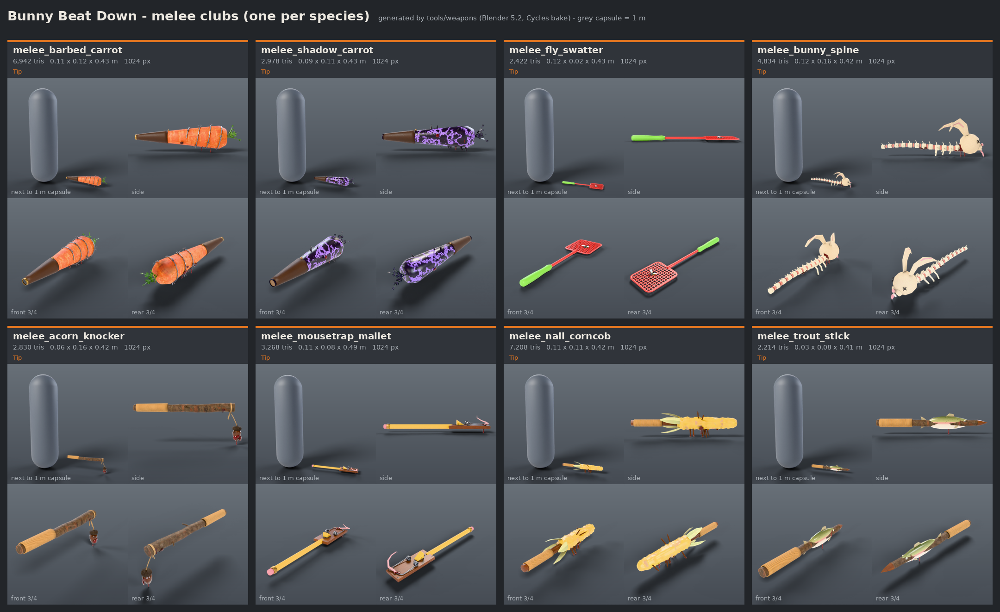
- **Gore**:
  - Any limb or head can come off any critter, as a real skinned body part
    with a clean, capped stump.
  - Blood fountains, splat decals, fur tufts and acorn helmets that fly off.
  - Three settings: **Full**, **Plushie** (stuffing instead of blood) and **Off**.
- **Situational awareness**:
  - Enemies have a warm rim light and a name tag within 45 m, which cover still hides.
  - Red minimap blips show anyone firing, anywhere on the island, and anyone
    moving within 20 m of you.
  - Enemy footsteps are directional: loud, strongly panned, and muffled when
    they're behind you. The audio listener sits at your critter's head, so you
    can hear where someone is and turn to take the shot.
  - Every carrot leaves a glowing tracer, so you can see shots fly and where
    they came from.
  - When you're hit, the shooter's name tag lights up at any range and an
    arrow points their way. Blood splats land on that side of the screen
    (stuffing with Plushie gore).
- **AI opponents** drive the same controls as you:
  - They loot, choose guns by range, strafe and jump in fights, lead targets,
    hear gunshots and react to being hit.
  - They have to *spot* you first. Each critter in view fills an awareness
    meter, quickly if it's close, moving or firing, and slowly if it's far,
    still or crouched. Bushes, ferns and tall grass hide you from bots just as
    they hide bots from you. Getting shot turns a bot toward the noise, but it
    still has to find you.
  - Only one to three bots (by difficulty) shoot at you at once, in bursts,
    and their hits on you are softened by difficulty.
  - They heal, flee the Briar, and path across a navmesh baked from tiles.
  - Bots that see each other up close always fight: no walking past each
    other like teammates. A director keeps the lobby alive for you instead:
    while it's thinning faster than a steady curve, bots hit each other
    softer and most scraps end with the loser running off
    (`tests/diag_brawl.gd` counts fights, bots that saw each other and did
    nothing, and the death toll over a 49-bot match).
- **Bots are characters, not targets: the same 49 every run.** Each has a
  name, a species, a voice (Hothead, Sneak, Show-off, Grudge-holder,
  Scaredy-cat, Prankster, Noble, Calm one), one of 14 fighting styles (Rusher,
  Sharpshooter, Ambusher, Brawler, Vulture, Duelist, Survivor, Hunter...) and
  a favourite carrot gun; no two share a style and a gun, so each fights a
  little differently (`Cast`: the AI reads its style as numbers: range,
  aggression, nerve, how it hears gunfire, whom it picks on). **Each wears its
  own look**, the same fur and outfit every match, picked to match who they
  are: Captain Carrot's captain's cap and medal, Sir Toadsworth's top hat and
  monocle, Dam Dan's hard hat, Sly the tracker's deerstalker, Bunnicula's
  cape, Timber's lumberjack beanie. Forty-odd hats, glasses, masks, scarves,
  capes and backpacks (CC BY models, credited in the game) are fitted to
  every species from its own mesh, ride on the bones, and fly off with a
  headshot. (Your own critter keeps the skins you pick.) The game remembers
  the score between each of them and you, across runs:
  - A bot that has beaten you down twice becomes your **rival**: it's always
    in your next matches (with a purple "⚔ RIVAL" name tag), it hunts you,
    and it taunts you in its own voice, in speech bubbles and the kill feed
    ("Didn't see me, did you? 3–1.") and **out loud**: all 49 rogues have a
    voice of their own (designed for each with Maya1 from a written
    description, many starting from a real speaker with the accent; those
    not yet recast still speak with Kokoro TTS: hamsters squeak, frogs croak,
    the nobles are British, the hotheads gabble), loud enough to carry across
    the field over the gunfire, and they comment on what you're wearing.
    Beat it and the game calls it **revenge**.
  - Beat the same bot down again and again and it **turns radical**: Sore,
    Vengeful, Unhinged, then your Nemesis. Its name tag says so; it picks
    fights from further off and stops running away, comes looking for you,
    drops in with its favourite gun (then armour too), stops waiting its turn
    to shoot at you, and always jumps when you do. The most radical one in a
    lobby has a **bounty** on it, paid in acorns.
  - Bots hold **grudges against each other**: the one that beat another down
    is a marked critter next match, hunted from twice as far away. Paying one
    back makes the feed ("Croaker got even with Vex.").
  - And **against the director**: the Briar catching them, and the pacing
    softening their hits, count against it. A bot that's had enough defies
    it (its hits are never softened) and curses it when the Briar moves.
  - The drop opens with the lobby's news: who you've made radical, who's
    feuding, who's furious with the director, and the bounty. The
    **Rogues' Gallery** (main menu) has a card for each of the 49: the
    rogue itself turning on a little stand in its outfit with its favourite
    gun (spin it with the mouse), who they are, how they fight, the score with you, their wins and grudges, and
    their own trackers (accuracy, headshots, damage, beat-downs by gun and
    their longest beat-down). **Reset all rogues** (at the bottom, asked
    first) starts all 49 over, no rivals, nemeses or scars, so new ones can
    rise; the signature guns you've won stay yours.
  - **Your Nemesis hunts you.** A bot you've beaten down eight times is your
    Nemesis: in a lobby it's tougher (half as much health again, full
    armour), its tag reads ☠ NEMESIS, the HUD shows how far it is and which
    way, and every 20 seconds it learns roughly where you are. Beat it down
    and it drops its **signature gun**: its favourite, Golden, with a
    mutation built in ("Sly's Golden Carrot SMG", with Piercing Carrots).
  - **Gangs.** When two or more bots you've made Vengeful are in a lobby, the
    three hottest gang up (*the Thorn Gang*, *the Muddy Paws*...): they drop
    in together, leave each other alone, hunt you, and the news says so.
  - **They come back marked.** Shoot a bot's head off and it returns in an
    eye patch (its head takes a quarter less damage); take an arm and it's
    bandaged, a leg and it's in a twig splint (tougher each time); blow it up
    and its fur comes back singed and sooty (blasts hurt it less). A bot that beats you down **takes the gun you
    were holding** and brings it to your next matches, in your skin, until
    you beat it down and take it back. The Rogues' Gallery remembers all of
    it, and its portrait wears the scars (the list marks who's scarred).
- **Runs down the Trail.** *A Run* (main menu) is five stops picked one at a
  time from a branching map (`Run`, `TrailPanel`): Skirmishes, Grudge Matches
  (your radical bots, as a gang), Golden Groves (better loot, double acorns,
  a harder goal), Picnics (no fighting: mend a helmet, find two rewinds or
  take a boon) and The Big Beat Down at the end, a full lobby with a nemesis
  hunt. Every stop has its own map, run modifiers and a goal: make the top
  few, or beat down enough critters. Miss it and one of your three acorn
  helmets cracks; lose all three and the run is over. Your boons, your
  rewinds (three for the whole run) and one **keepsake** gun (pocketed at
  the end of a match) carry from stop to stop, and a run survives quitting
  the game.
- **Boons: a build that grows as you go.** Acorn shrines on every map (hold
  interact to pray; bots walk on by) and every goal you make on the Trail
  offer one of three boons (`Boons`, `DraftPanel`); picking one again levels
  it up. Four families: **Bramble** (Thorny Carrots make critters bleed,
  Bramble Coat hits back, Cruel Thorns, Splinters), **Sugar Rush** (speed,
  higher jumps, faster reloads, Carrot Frenzy), **Mutations** (Splitting
  Carrots burst into shards, Piercing Carrots go through critters, Bouncy
  Carrots ricochet, Popping Carrots go off) and **Deep Roots** (Thick Skin,
  Carrot Juice heals you, Acorn Shell, Hush). Hold two families and their
  **duo** can turn up: Briar Shards, Second Breakfast, Ricochet Rush, Bark Skin.
- **The bots learn you.** They remember where you like to land (and more of
  them head there), and which guns you win with (they fight you at the
  range those guns are worst at). Sit still too long and the nearest bots
  come to flush you out; go on a hot streak and they sharpen up for a while.
- **The Burrow (roguelike progression).** Every match pays acorns (by
  placement, beat-downs, revenge on rivals and bounties). Spend them in the
  Burrow on perks that are real power, because there's nobody else's
  fairness to protect: Thick Fur (drop in with 50 shield), Pocket Clovers,
  Quick Paws, Spring Legs, Lucky Start (land with a Prize-tier gun or
  better), Second Wind (survive one killing blow), Light Step, Hawk Eye, Big
  Appetite, Deep Pockets, Adrenaline (beat-downs heal), Thorn Coat (the
  Briar hurts half as much), Regrowth (a shield that grows back), Scavenger,
  Acorn Magnet and Bounty Hunter. Take two into each match, three once
  you've built A Bigger Burrow. Run modifiers change a match and how much it
  pays: Low Gravity, Glass Cannon, Golden Hour, Briar Rush, Pea Soup (fog),
  Fragile Fluff (everyone on half health), Rocket Party (every gun a rocket
  launcher), Most Wanted (the nearest bots are told where you are), Stampede
  and Clover Drought.
- **Milestones (mastery).** Eighteen goals read off your trackers, each
  unlocking something for good (`Mastery`, the Trophy Room's second page
  shows your progress): master a gun and its carrots change in your paws
  (15 pistol beat-downs and they bounce, 25 with the SMG and they pop, 20
  with the shotgun and its pellets split, 20 with the rifle and they pierce,
  and so on), 10 rocket beat-downs widen your blasts, 10 with the club make
  it hit harder; 50 headshots, a win and making a Nemesis unlock Workshop
  looks; finishing a run gives every run a fourth acorn helmet, clearing
  three stops a fourth rewind, holding six boons at once makes drafts offer
  four; and five wardrobe pieces can only be earned (three wins for the
  mortarboard, 30 rogues beaten for the jester's cap, 25 sniper headshots
  for the star glasses, three runs for the fairy wings, two nemesis hunts
  for the dark wings). Adding one is a row in a table.
- **The Workshop (in the Burrow): gun upgrades and looks, bought with
  acorns.** Attachments go on every gun you pick up: a Red Dot Sight on the
  gun's own sight line (in first person you aim through its tube at the
  dot; aimed shots 25% tighter), a Carrot Quiver (30% bigger magazines), a
  Muffler (bots hear your shots half as far and your flash doesn't give you
  away), a Laser Pointer (a beam, and tighter hip fire) and a Padded Stock
  (less bloom). Looks: seven reticles (cross, dot, circle, chevron, carrot,
  acorn, paw print) in six colours, seven gun skins (a shader over the
  gun's own materials: fern camo, candy stripe, midnight, bubblegum, frost,
  gilded), muzzle-flash colours (rainbow too), muzzle smoke, your tracer
  colour and the burst when you beat a critter down (confetti, autumn
  leaves, a carrot shower, hearts). **Your wardrobe** is yours alone (no
  rogue wears any of it): a hat (ear-flap beanie, flower crown, Santa hat,
  fedora, witch's and wizard's hats, a mortarboard, a jester's cap),
  something for your face (heart, 3D, pixel and star glasses), a necklace,
  and something on your back (butterfly, fairy or dark wings, a jetpack),
  fitted to whichever critter you play like the rogues' outfits and shown
  on you beside the list as you browse, bought or not. A hat takes the
  acorn helmet's place. `tests/capture_workshop.gd` renders them
  all.
- **Rewind.** The game records the last ten seconds of the match, and you
  get three rewinds a match (on a run, three for the whole run): press **T** (or pick *Rewind* in the pause
  menu), or take one when a killing blow lands, since the game freezes and
  asks "rewind, or accept defeat?" instead of letting you drop. For about a
  second the world runs backwards like an old tape: everyone glides back the
  way they came and the Briar grows back. Then everyone still standing lands
  where they were ten seconds ago, with the
  health, shield, guns and ammo they had then; the loot they picked up since
  goes back on the floor; carrots in flight vanish; and the Briar's clock
  winds back. Critters beaten down in those ten seconds stay down. (It only
  works because it's you against bots.)
- **The final shot, replayed.** When the last-but-one critter goes down,
  time slows to a crawl. Then the world freezes and the shot plays again
  from three angles: over the shooter's shoulder, riding the carrot in
  bullet time, and circling the beat-down. Any button skips. It's a real
  replay, not a re-enactment: once a few critters are left, the KillCam
  records the fight (every bone of every fighter through a skeleton
  modifier, plus carrots in flight, rockets, gibs, blood and sounds) and plays
  the recording back with the match paused. You see it when it's your win,
  your beat-down, or a fight you're spectating.
- **A Briar with moods.** Every match rolls one, announced as you drop:
  the *Hungry* Briar closes each circle in on you, the *Sticky* one slows
  you in its thorns, the *Bribable* one naps for 15 s if you munch a lucky
  clover in its thorns, the *Wandering* circle never stops drifting, the
  *Sleepy* one waits longer but bites twice as hard, and the *Bouncy* one
  bounces you sky-high. (A quarter of matches get the classic Briar.)
- **Procedural island** from a seed, 1.3 km across, in three biomes:
  - a hilly **forest** with ridges and valleys, giant oaks and ferns;
  - open **grasslands** of rolling meadow, flat-topped mesas and wildflowers;
  - a **swamp** of knee-deep still water (wading slows you down) with
    cattail reeds you can hide in, lily pads and bare dead trees.
  - Big walk-in buildings in each biome, with their crates, loot and
    usually a treasure chest inside: the log **Woodcutter's Lodge** (thatched
    roof, stone chimney, porch), the **Big Red Barn** (gambrel roof, swung-open
    doors, stalls and hay bales, a carrot weathervane) and **stilt shacks**
    with tin roofs and ramps out over the swamp water.
  - Seventeen named landmarks in all, among them Carrot Patch, Picnic Hill,
    Mushroom Ring, Duck Pond, Gnome Garden, Hollow Stump, Boulder Bluff,
    Log Jam, Bayou Shacks and Haystack Barn.
  - Paths, ground cover that bends in the wind, PBR terrain and water. The
    textures are mipmapped and toned toward their average colour, with gentle
    bumps, SMAA on top of MSAA and alpha-to-coverage leaves, for a smooth,
    cartoony look instead of photo grain.

  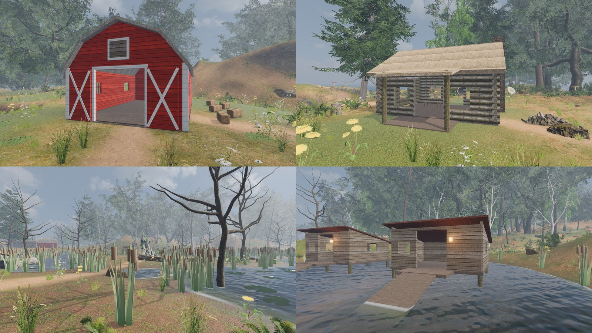
- **The Hamster Cage**, a second map: a 1.1 km glass tank full of
  wood-shaving bedding, standing in a human's living room, with its own
  toy-box chiptune soundtrack. Everyone flies in on a wind-up tin biplane,
  with a goggled mouse in the cockpit.
  - **Bedding**: a giant exercise wheel, *Tube Town* (Habitrail pods joined
    by tunnels you can run through), hamster huts, a food bowl heaped with
    seeds, a sand bath, a shelf with a ramp, the water bottle on the glass,
    cardboard rolls, chew blocks, and giant seeds, pellets, broccoli and
    carrots lying everywhere as cover (paper-bedding tufts hide you like bushes).
  - **The Hamster Gym**: perches on stilts at 7, 14 and 21 m, joined by
    see-through Habitrail tubes in every colour that you walk up inside,
    with a skybridge tube, two slide tubes back down and a hammock. Lookout
    perches with ramps stand around the cage too, along with bendy wooden
    bridges, coconut hideouts, chew-stick bundles and egg cartons.
  - A **lagoon** of spilled water over aquarium gravel round five brimming
    water bowls (swim in, climb out over the rim), an aquarium castle, shells
    and plastic plants.
  - A **winter corner** next to a giant fridge the owner left open behind
    the glass, stocked with cartoon food (milk, cheese, a layer cake,
    pancakes, fruit, carrots in the crisper and squeezy sauces in the door):
    cold light and mist pour over the wall, and there are snow
    drifts, icicles, frost on the panes, ice cubes, frozen peas, popsicles
    and an upturned ice cream tub to hide in.

  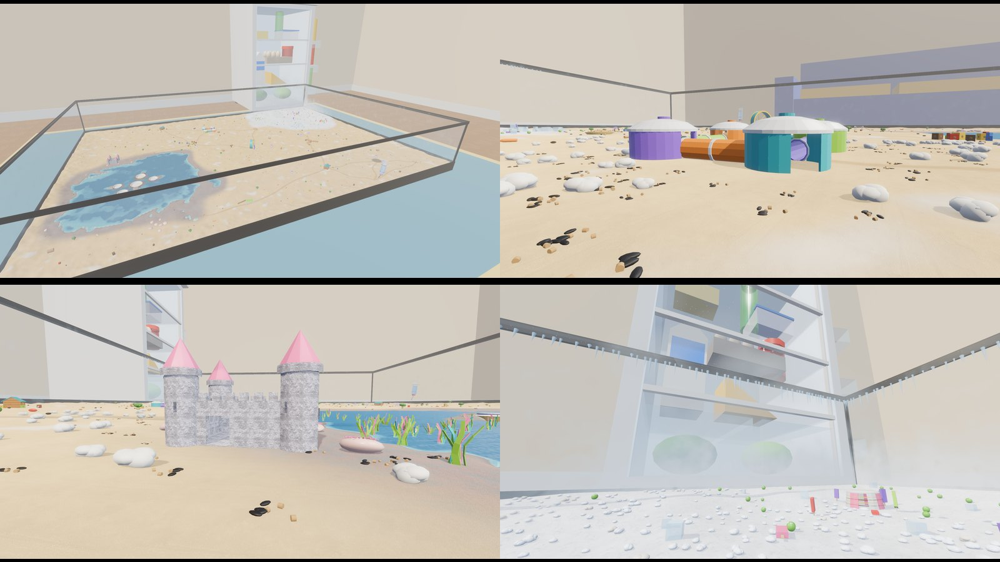
- **Toy Box Bash**, the third map: a kid's bedroom floor, hemmed in by the
  bed, a cubby shelf, a bookshelf, a dresser and a desk, under a ceiling of
  glow-in-the-dark stars and a planet mobile, to a toy-box soundtrack (music-box
  bells, a peppy vibraphone and a tin-soldier march).
  - **The toy train** loops the whole room on a wooden track. Hop on an open
    car and ride it (moving cover with a view), but don't stand on the track:
    the engine bonks you for real damage and knocks you flying.
  - **Dollhouse Manor**: three storeys, open at the back, with stairs up
    through every floor and loot on each one.
  - Oak floorboards with a printed town **play rug** (roads, lawns and a
    river) under **Brick City** (plastic-brick houses and towers) and the
    **Loop-de-Loop** race track; an alphabet-**Block Castle**, **Crayon
    Canyon** with a coloring-book tent, a **Domino Run**, a tea party, the
    toy chest, a piggy bank and a toy rocket.
  - A corner of **pillow hills** under a patchwork quilt with a blanket fort
    and a giant teddy, and a **fishbowl** with goldfish: climb the slide,
    jump in and swim.

  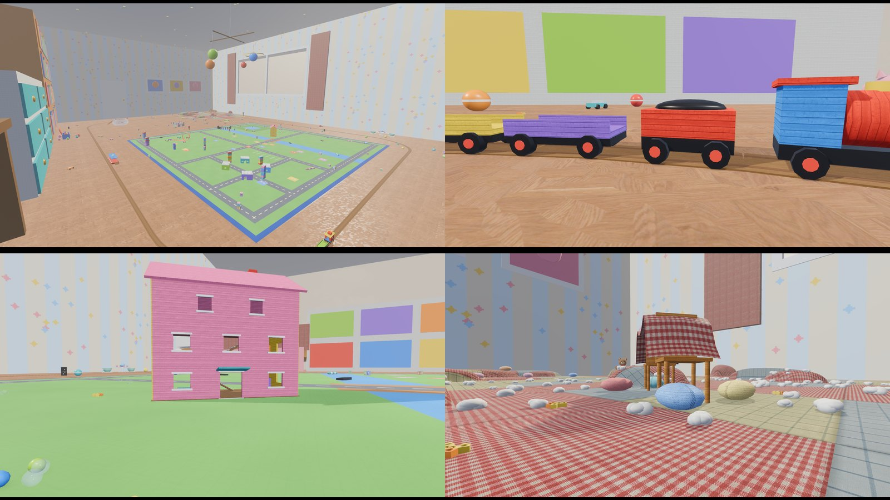
- **Full UI**: menus, settings, pause, loading screen, gamepad support, and a
  [credits page](CREDITS.md) generated from the asset metadata.

## How it's built (the interesting parts)

The full write-up is in [docs/ARCHITECTURE.md](docs/ARCHITECTURE.md).

- **Keyframe-free animation.** Characters come from different artists with
  different rigs, so animation is driven by bone *roles*. A custom
  `SkeletonModifier3D` runs every frame:
  - It computes a velocity-synced gait (bunnies hop), leans into a run and
    pumps empty paws; turning on the spot, planted feet step round.
  - It spreads aim across the spine and moves the hips.
  - It layers **idle life** on top: breathing (panting after a sprint), a
    slow weight shift, glances around, and each species' own fidgets (a
    bunny's warning thumps, a squirrel's nibble, a fox's tail swish, a
    stretch, an ear scratch, a look over the gun).
  - It carries guns like a person would: up on the aim when shooting,
    aiming or alert, lowered when things go quiet, swung across the body at
    a sprint, and moved clear of big cartoon heads. Shots always leave from
    where the raised muzzle would be, so how a gun is carried never changes
    the aim.
  - It solves **analytic two-bone IK** so the paws hold each gun's real grip
    markers, closing into fists round the handles (paws measured from each
    model's mesh; mitten paws with no finger bones get knuckles at load).
    Every critter is tested with every gun.
- **Dismemberment without pre-cut meshes.** A severed limb is a copy of the
  same skinned model with its skeleton *re-rooted* at the cut bone. On the
  corpse, a final modifier collapses the missing subtree into the stump; on
  the gib, the rest of the body collapses *into the cut*, so skin shared
  across the joint pinches shut instead of stretching off in spikes. This
  works on every model in the roster.
- **One body, two brains.** Players and bots write the same intent struct, so
  bots get no aim or movement cheats.
- **Deterministic island generation**: fBm, ridged and mesa terrain blended
  by a noise-warped biome map, a splat-map shader (with a swamp-mud layer),
  biome-aware POI placement and flattening, a scatter system with cached
  collision, a spatial hash for spacing and MultiMesh ground cover, buildings
  assembled in code from textured boxes and logs (every wall run is a
  collider, so doorways are real gaps for the navmesh), and a tiled async
  navmesh bake. The Hamster Cage reuses all of it: `HamsterCage` extends
  `Island` (bowl water, a rectangular play area, its own ground colours and
  light), `CageFloor` extends `Terrain`, and its toys are built by a
  `CageKit` that adds lathes, panel rings and ellipsoids to the buildings'
  boxes and logs. Toy Box Bash does the same (`ToyBox`, `ToyFloor`,
  `ToyProps`, `ToyRoom`), plus `ToyTrain`: `AnimatableBody3D` cars
  following a resampled loop, so riders are carried by the physics engine,
  and a bumper `Area3D` that bonks critters on the line.
- **Both indoor maps are drawn as models; the code keeps the gameplay.**
  Every kit still builds its colliders, footprint, floors and loot spots
  from its primitives, then `CageKit.dress()` swaps what you see for a
  model. Food, toys and furniture are CC-BY models from Sketchfab, through
  the same vetted pipeline as the island (`tools/env`). Things no model
  exists for are made in Blender from code (`tools/maps/models.py`: plastic
  plants, chew blocks, dominoes with real pip layouts, marbles, the train
  track swept round its loop...). The walk-in structures are rebuilt from
  the kits' own geometry: `tests/export_kits.gd` writes each kit out, and
  `tools/maps/refine.py` welds it, bevels every hard edge and rounds off
  curved parts in Blender. So a pod's doorways in the model are exactly the
  collider's. Model materials named `cage:<key>` take the game's own
  materials, and `accent` slots take a colour per instance, so one model
  covers every coloured variant.
- **The island's lodge, barn and stilt shack are models too.** `Building`
  records every box, log and prism it builds (and its wall runs, with their
  doors and windows) when `tests/export_kits.gd` asks, and
  `tools/maps/island.py` builds each piece again in Blender, to the same
  size and place, with real detail: separate boards (board-and-batten on the
  barn, lapped siding on the shack), stacked logs with chinking and end
  grain, layered thatch with a ridge roll, slate courses, corrugated tin,
  chimneys and plinths of single stones, framed windows with shutters and
  flower boxes. UVs are in metres, so the models use the buildings' own
  textures (each board shows one plank of the texture), and the colliders
  still come from the code.
- **Levels of detail, measured.** `tests/perf_bench.gd` renders each map from
  fixed views (the drop, every landmark) and reports GPU and CPU time,
  triangles and draw calls, with the shadow passes apart; with `breakdown`
  it hides each kind of thing in turn to show what the triangles are. That
  found the real costs (not the models I expected): terrain with no LOD,
  ferns casting shadows 170 m out, and 5,000-triangle snowballs. Now each
  terrain chunk carries coarser grids on the same vertices, each tagged with
  its exact height error, so Godot picks one by its size on screen, with
  shallow skirts so neighbours at different detail never crack (deep ones
  cost more GPU time in the shadow cascades than the LODs saved, so grids
  too rough to ever be picked aren't built). Cover keeps its models' LODs
  and casts shadows only near you (a shadow-only twin of each batch); island
  buildings hand over to the code-built building their model was made from
  past 140 m; lower quality settings allow a few pixels of LOD error. On
  the same views: 31% fewer triangles on the island, 31% on the Hamster
  Cage, 79% on Toy Box Bash, and a third to two thirds fewer shadow
  triangles.
- **Tests that play the game.** A headless suite of 134 tests covers:
  - the IK maths, hitboxes, ragdolls and dismemberment, and how critters
    carry themselves (never frozen, guns carried low but shooting from the
    aim, held clear of the head, both paws on the handles of every gun, feet
    stepping round on a turn);
  - island navigation, the three biomes and the big buildings (a Bun walks
    in through the barn doors; every indoor loot spot is reachable on the
    navmesh), the Hamster Cage (bots can walk into every pod, hut, castle and
    tub, up the Hamster Gym's tubes and onto every lookout; the glass holds;
    the bowls are swimmable), Toy Box Bash (every floor
    of the dollhouse is reachable; the train runs, carries a rider and bonks
    whoever is on the track; the fishbowl is swimmable), that no prop is
    generated inside another and no loot inside a solid, and the game rules;
  - how carrots fly (on the crosshair within range, little leading at each
    gun's range, bursts that bloom and settle, the shotgun's pattern) and
    the trackers (shots, pellets, blasts, headshots and beat-downs counted
    per gun and per critter, the HUD counter, the Trophy Room, and each
    bot's own counts on its Rogues' Gallery card);
  - the roguelike layer: boon drafts, levels and duos, bleeding, thorns and
    Carrot Juice in a match, carrots that split, pierce, bounce and pop,
    acorn shrines, a run down the Trail (goals, helmets, rewards, picnics,
    the finale and its retry), a nemesis hunt and its signature gun, gangs,
    scars and your stolen gun, and the Trail and draft screens; milestones
    (reached once, paid once, each unlock acting only for you);
  - the cast (49 characters, each fighting its own way and wearing its own
    outfit, every piece fitted to every species; a full lobby with
    no "Fox 3"), rivals (made, remembered across runs, back in the next
    match, hunting and taunting, revenge), radical bots (each step, their
    loadout and name tag, the bounty), grudges between bots and against the
    director (paid back, remembered, a defiant bot's hits), the lobby news
    and the Rogues' Gallery, the bots learning you (landings, fighting style,
    camping, hot streaks), every Briar mood, the Burrow (earning,
    unlocking, equipping, every perk and modifier in a match, the third
    slot, the Workshop's attachments and looks on your guns), rewinds
    (everyone and everything put back; the world running backwards first;
    the killing-blow offer) and the final-shot replay (recorded bone by bone
    with the carrot that did it; slow motion, then the replay with the world
    frozen; skipping; everything as it was afterwards);
  - the player's input loop through real keyboard and gamepad events (menus,
    crouch → crawl, the L3 + R3 chord, aim assist, one gun in first person)
    and licensing;
  - **a complete 8-bot match on each map** that must loot, fight and finish.

  CI runs it on every push.

## Running it

**Download and play:** Linux and Windows builds are on the
**[latest release](https://github.com/zconnor100-debug/bunny-beat-down/releases/latest)**
(about 400 MB for Linux and 480 MB for Windows; you need a GPU with Vulkan).
On Windows, run `BunnyBeatDown-Setup-windows-x86_64.exe`: it installs the game
(no admin rights needed) and puts a Bunny Beat Down shortcut on the desktop
and in the Start menu, with an uninstaller in Settings → Apps. Right-click
that desktop icon → "Update Bunny Beat Down" (on Windows 11 under "Show more
options", or from the Start menu) to install the newest release over it;
or take the
zip, which is the whole game in one `BunnyBeatDown.exe`. On Linux, extract
the tarball and run `./install.sh` in the `BunnyBeatDown` folder for a
desktop launcher and a menu entry; right-click it → "Update Bunny Beat Down"
(on the GNOME desktop under Scripts) to update (`tools/installer/`).

**Graphics and screens.** Settings has five quality tiers (Low to **Epic**:
screen-space reflections from Ultra; volumetric light shafts, finer LODs,
denser foliage and ultra-soft shadows on Epic), a choice of anti-aliasing
(FXAA, SMAA, TAA, MSAA up to 8× with SMAA, FSR 2 native AA), resolution
scaling (FSR 2 Quality/Balanced/Performance or 150% supersampling), window
mode, V-Sync and a frame-rate cap. For wide screens: the **screen shape**
(fill the screen, or standard 16:9 / ultrawide 21:9 with black bars), a HUD
kept to a 16:9 or 21:9 column, and a field of view that stops stretching
past 21:9. If a GPU draws things wrongly, **Graphics API** switches to
Direct3D 12 or the Compatibility renderer (after a restart); the settings
screen says which API and GPU the game is running on.

**Updates are automatic.** Every push that changes the game, once the tests
pass, is built for Linux and Windows, smoke-tested on each (a headless drop
onto the island: the Linux build on Linux, the Windows .exe on a Windows
runner) and published, only if both pass, as a new release by
[`.github/workflows/release.yml`](.github/workflows/release.yml), so the link
above always has the newest build. Versions only go up (`tools/release_version.py`:
v0.6.1, then v0.6.1.1, v0.6.1.2, ... until the next line in `project.godot`),
the notes are written from the commits since the last release plus any
highlights in `docs/release_notes/` (`tools/release_notes.py`), and the game's
main menu shows an **Update ready** button when a newer version is out
(`src/ui/update_check.gd`; Settings → "Check for updates" turns it off).

**Desktop app (Linux):** run `./tools/install_desktop.sh`. It adds *Bunny Beat
Down* to your applications menu and desktop, with Bun as the icon. If a
standalone build exists in `build/linux/`, it launches that; otherwise it runs
the project through Godot.

**From source:**

1. Install **[Godot 4.6.2](https://godotengine.org/download)** (standard build).
2. `git clone https://github.com/zconnor100-debug/bunny-beat-down.git` and open `project.godot` (the first import takes a minute). On Linux you can also run `./play.sh`.
3. Press **F5**.

```bash
# or from a terminal
godot --path .                                          # play
godot --headless --path . -s tests/run_tests.gd         # all tests (~3 min)
godot --headless --path . -s tests/run_tests.gd -- ik   # one suite
godot --headless --path . -s tests/check_scripts.gd     # compile every script
godot --path . -s tests/perf_bench.gd -- perf.json      # frame cost per map (GPU window)
# before exporting a release: GPU-compress the textures extracted from the models
python3 tools/compress_textures.py && godot --headless --import
```

### Controls

| Action | Keyboard / mouse | Gamepad |
|---|---|---|
| Move / look | WASD / mouse | Left / right stick |
| Fire / aim (scope) | LMB / RMB | RT / LT |
| Jump (with species trick) · glide · leave the balloon | Space | A |
| Sprint (works while aiming) | Shift (hold) | L3 (click: on until you stop) |
| Crouch → crawl → stand (each press) | Ctrl or C | B (with a gun out) |
| Pick up / open (with a gun or crate in front of you), else reload | E / R | X |
| Club swing (any time) | F, or LMB with empty paws | R3, or B / RT with empty paws |
| Switch weapon / drop it | 1-3, mouse wheel / G | LB / RB / D-pad ← |
| Heal (lucky clover) | H | D-pad ↓ |
| Carrot grenade: hold to aim its arc, let go to throw | X or middle mouse (hold) | Y (hold) |
| First / third person | V | Back, or L3 + R3 together |
| Swap shoulder | Q | D-pad → |
| Map | M (hold) | D-pad ↑ |
| Pause | Esc | Start |
| Rewind 10 seconds (3 a match) | T | Start, then *Rewind* |
| Skip the final-shot replay | any key | any button |
| Menus: move / select / back | Arrows / Enter / Esc | D-pad / A / B |
| Character picker: critter / skin / spin | ← → / ↑ ↓ / drag | D-pad ← → / D-pad ↑ ↓ / right stick |

On-screen prompts follow whichever you used last (“[X] Pick up” vs “[E] Pick up”).
On a gamepad a light aim assist helps: when the crosshair passes within 2 m of
an opponent you can see, the stick slows a little and the aim drifts onto them.
Pads with back buttons (an 8BitDo Ultimate's L4 / R4): map them to L3 / R3 and
squeeze both for first person.

## Assets and credits

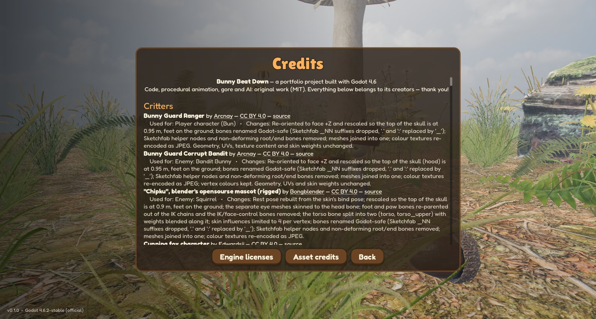

Every model, texture, sound, track and font is **CC0, CC BY or SIL OFL**.
Each one is credited with its author, source link, license and the changes
made in [CREDITS.md](CREDITS.md), and on the in-game **Credits** screen. Both
are generated from the same `assets/credits/*.json`. A test fails the build if
any asset file lacks a credit. The pipelines that fetched, vetted and
normalised the assets (Sketchfab / Poly Haven / ambientCG / Kenney /
incompetech) live in `tools/`. The carrot guns, helmet and pickups were
modelled from code in Blender (`tools/weapons/`), and so were the Hamster
Cage's and Toy Box Bash's original models (`tools/maps/`).

## Development notes

This project was built with an AI pair-programmer (Claude Code) as part of
exploring agentic software development. That covered the game code and tests,
plus parallel asset agents that sourced, license-vetted, normalised and
documented the art and audio pipelines.

Two small local web tools (standard-library Python, loopback only) close the
loop with a human reviewer:

- **Audio Review** (`tools/audio/review.py`): play every sound, mark it Good,
  Tweak or Replace, flag bad takes and leave notes. Sounds rebuilt since a
  verdict are marked for a second listen.
- **Game Notes** (`tools/notes/notes.py`): write down changes you want, one per
  note. Once nothing has been added for 10 minutes, Claude claims the new notes,
  makes the changes, and answers each note on the page (done, or a question).

The phone trailer is a cut of short shots recorded a map at a time
(`tests/trailer_reel_stage.gd`, with the bots in the battles driven by a few
lines each: nearest foe, strafe, burst fire) and put together by
`tools/make_reel.py`, at full 1080p in two shapes (1080×1920 for phones,
1920×1080 for widescreens): a high-quality master and a cut under 16 MB to
send in a message. Godot renders the frames at full size even in a window
that fits on the screen (a temporary `override.cfg` with the viewport at
1080p and `stretch/mode="viewport"`). Its music is "Run Amok" by Kevin MacLeod.

The other trailers are directed: the shots and the two critters' inputs are scripted
(`tests/trailer_stage.gd`, `tests/trailer_cage_stage.gd` for the Hamster
Cage cut and `tests/trailer_toybox_stage.gd` for the Toy Box Bash cut), but
everything on screen is the running game (the
island, the rival's name tag and taunts, the killing-blow prompt, the rewind,
the REVENGE banner). Godot's Movie Maker records it frame by frame with the
game's own sound, and `tools/make_trailer.py` cuts the MP4 and the GIF. Music
in the trailers: "Scheming Weasel (faster version)" (the island cut),
"Pixel Peeker Polka - faster" (the Hamster Cage cut), "Itty Bitty 8 Bit" (the
Hamster Cage phone cut), "Divertimento K131" (the Toy Box Bash cut), "March of
the Spoons" (its phone cut) and "Fiddles McGinty"
(the Hamster Cage and Toy Box Bash endings), all by Kevin MacLeod ([incompetech.com](https://incompetech.com)), licensed
under [CC BY 4.0](https://creativecommons.org/licenses/by/4.0/). The phone cut
is laid out at 1080×1920 but rendered in a 720×1280 window, since Movie
Maker keeps the project's window size and a 1920-pixel-tall window doesn't
fit on the screen. A temporary `override.cfg` sets that up, and
`make_trailer.py --size 1080x1920` scales it back up.

## License

Code © 2026 Zachary Connor, [MIT](LICENSE). Third-party assets keep their own licenses. See
[CREDITS.md](CREDITS.md).
